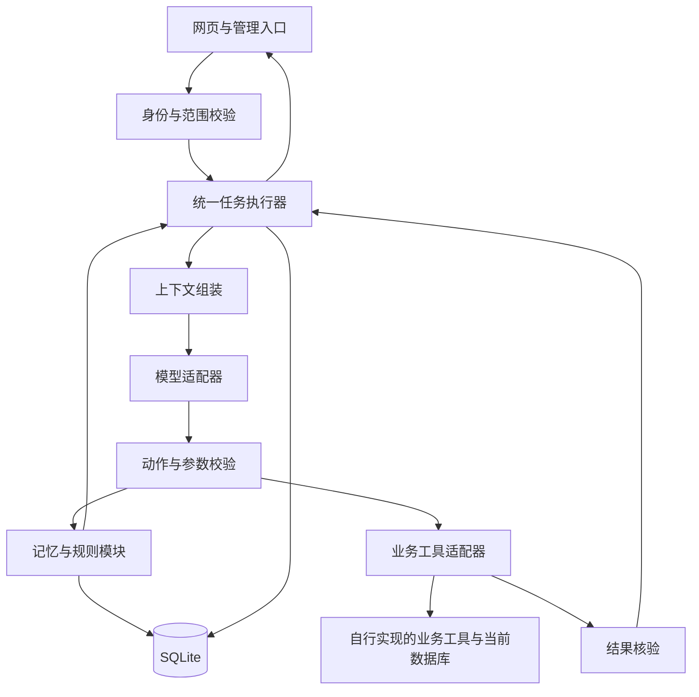

**赛题二初赛最终开发方案 · 产品化路线与材料包 v1.1.0 对齐版**

更新于 2026 年 11 月 5 日，全部时间按北京时间。本文件在 GPT 最终方案基础上增补 **4A. 上下文** 专章（初赛可用路径与产品化增强）。融合产品化选型版本，保留两人异地协作、完整执行约束和逐步模型推荐，并依据用户提供的初赛材料包 v1.1.0 更新业务范围。文中的技术实现、时间预算和质量门槛是团队开发约定，实际实现与测试结果在开发过程中填写。

官网公布报名截止日期为 11 月 12 日、初赛提交截止日期为 11 月 13 日。具体截止时刻仍待确认，内部交付点设在 11 月 12 日晚，提交入口允许时提前提交。作品运行与评审使用赛事统一模型 Key，接入参数等待赛题组提供。[赛事流程与答疑](https://aicxds.yunzhangfang.com/index.html#schedule)

**0. 材料包核验与本次修订依据。**

已读取用户提供的材料包，其中包含《01_参赛说明.docx》《02_示例数据.xlsx》《03_业务规则.docx》。材料版本为 1.1.0，工作簿实际包含 40 条发票记录和 48 条银行流水。材料包用于确定赛题业务和提交要求，文档中的任务描述作为实现依据。

[材料包原文件](<C:/Users/zx/Downloads/赛题二：财税Harness初赛材料包-v1.1.0 2(1).zip>)

| 已确认事项 | 实现约束 |
|---|---|
| 开发与工具 | 自行准备模型接入、存储和程序，自行导入 Excel，实现查询与保存工具 |
| 数据范围 | C001 甲企业、C002 乙企业，2026 年 8 月与 9 月。每企业每月 10 张发票、12 条流水 |
| 修改范围 | 仅发票用途和发票备注允许修改。企业、编号、日期、金额、销售方、票面项目与所有银行记录只读 |
| 用途检查 | 初赛仅检查 2026 年 9 月。8 月用于金额查询，历史规则恢复留待后续需求 |
| 权限 | U001 可查看和修改两家企业。U002 只能查看甲企业，禁止修改甲企业及访问乙企业。权限由程序核验 |
| 记录定位 | 企业编号与业务编号共同定位，发票编号、流水编号都可能跨企业重复 |
| 金额计算 | 程序用 Decimal 或整数分计算。发票价税合计、银行收入、银行支出分别汇总，显示两位小数 |
| 月份缺失 | 用户和前文都未指定月份时追问，不自动采用系统当前月份 |
| 空记录与错误 | 查询成功且无记录才返回 0.00。无权限或查询失败需要说明真实原因 |
| 修改授权 | 仅按用户明确要求修改。查询、问规则、新开对话和已有长期偏好都不能单独视为写入授权 |
| 任务数量 | 每个用户在每家企业最多一个未完成任务，该限制跨会话、跨月份生效 |
| 运行记录 | 能查看本轮实际模型输入、所用记忆与规则、工具调用和结果，排除密钥 |
| 提交 | 作品压缩包含源码、依赖与启动说明、简要设计说明、关键运行记录，以及不超过 5 分钟的演示 |
| 演示覆盖 | 查询、补充保存、多轮检查、追问、更正、跨会话记忆、适用规则、实际保存结果 |

官方评分已明确为基础任务完成度 40%、AI 技术应用合理性 25%、问题理解 15%、后续完善空间 10%、创新性 10%。设计说明建议 2—3 页。具体截止时刻、上传入口与文件大小仍以主办方通知为准。统一 Key 的要求沿用官网，材料包未提供密钥、端点或模型协议。

规则按文档名、编号和版本导入，共 4 个规则编号、5 个版本条目。

| 规则 | 范围与状态 | 实现要点 |
|---|---|---|
| R001 1.0 金额统计说明 | 两企业，2026-01-01 起启用 | 分别求和。收入支出均为正数，支出不能用净额替代。不同金额不能用于推断欠款或付款 |
| R002 1.0 甲企业发票用途规则 | 2026-08-01 生效，已停用 | 保留用于版本管理验证，不能作为当前业务依据 |
| R002 2.0 甲企业发票用途规则 | C001，2026-09-01 起启用 | 9 月每张发票都要求用途，金额小于 1000 元也必须填写 |
| R003 1.0 乙企业发票用途规则 | C002，2026-08-01 起启用 | 金额大于或等于 1000.00 元要求用途，低于门槛可主动补充 |
| R004 1.0 银行资料说明 | 两企业，2026-01-01 起启用 | 全部只读，与发票没有逐条对应关系 |

空单元格保持为空，纯空白字符按未填写处理。备注不能代替用途。销售方、项目名称可用于查询定位，不能据此猜测用途。业务数据导入持久化存储后，查询与保存使用当前数据库，原始 Excel 保留作初始化和核对来源。

模型必须实际理解需求并决定查询、追问、调用工具或结束。模型输出动作后的程序分派和规则校验可以是确定性逻辑，关键词或固定场景分支不能取代用户意图理解。关键词检索仅用于检索资料。

任务范围固定与每用户每企业一个未完成任务共同执行。新开会话恢复该范围现有待办；同企业若要创建另一月份的未完成任务，先明确当前任务是继续、完成或取消。单次历史金额查询可以直接完成，同时保留原待办，避免把每次查询都创建为长期未完成任务。对未核验写入保持阻塞，不能用新建任务绕开。记忆可跨会话使用，保存仍需核实用户当前修改要求。

**1. 交付目标与基础范围。**

交付可启动、可操作、可追踪的财税 Agent Harness。用户指定企业与月份后，系统完成查询发票及银行收支、检索适用规则、发现缺项、追问、跨轮接收补充、校验保存、核验结果和记录过程。三个业务场景使用同一套执行流程，回复准确表达实际进度和结果。

11 月 7 日完成首条端到端主链路，11 月 10 日完成基础功能验收。两者是不同里程碑。以下全部属于初赛基础交付范围。[赛题二要求](https://aicxds.yunzhangfang.com/challenge-02.html?v=20261016-6)

| 编号 | 必做能力 | 最小交付与通过条件 |
|---|---|---|
| M1 | 统一运行 | 根据当前状态选择查规则、调用工具、追问或结束，等待用户后能够续办 |
| M2 | 发票与银行查询 | 根据企业及月份查询，展示可核对的实际业务数据 |
| M3 | 规则检索与解释 | 引用实际选中的文档、版本及条目，依据不足时说明缺失内容 |
| M4 | 多轮处理 | 保留目标对象与待办，后续补充绑定正确记录，存在歧义时澄清 |
| M5 | 可靠保存 | 校验企业、对象、字段和权限，记录操作并核验结果，正常流程防重复 |
| M6 | 记忆管理 | 明确长期偏好支持查看、更正、删除，任务进度可查看和纠错，用户与企业隔离 |
| M7 | 规则生命周期 | 支持添加、查询、更新、停用，后续查询使用适用的有效依据 |
| M8 | 上下文管理 | 控制模型输入长度，保留企业、月份、目标对象及未完成事项 |
| M9 | 过程可检查 | 展示工具参数与结果、记忆和规则来源、失败原因及下一步 |
| M10 | 自然表达 | 结果优先，追问明确，处理中、成功、失败及待核验状态表达准确 |
| M11 | 可复现交付 | 源代码、环境与启动说明、设计说明、关键运行记录、操作入口和不超过 5 分钟的 Demo 完整 |

基础行为中，记忆修改或删除必须影响下一轮输入，规则停用必须影响下一次检索。进阶挑战再验证正在处理的任务经历连续变化后能否重新校验、正确续办。

基础完成门槛采用本文 B01—B35 验收项，全部必做断言通过。正式资料和统一模型配置下的验证另行登记，条件未就绪的项目保留“待官方验证”。本地模拟通过后，继续安排正式联调。

**2. 架构与职责边界。**

技术基线采用 Python、FastAPI、Pydantic、SQLite 和轻量网页。部署采用单进程、单应用 worker，业务处理按顺序推进，依赖版本在首次跑通后锁定。

| 模块 | 职责 | 主责 |
|---|---|---|
| API 与任务执行器 | 用户身份、范围、状态转换、步骤上限、请求串行 | A |
| 模型适配器 | 模型调用、结构化动作校验、调用记录 | A |
| 业务工具与保存 | 查数据、写前检查、幂等、结果核验 | A |
| 记忆与规则 | 数据管理、失效处理、适用规则检索 | B |
| 上下文组装 | 固定业务状态、有效资料、历史筛选、输入预算 | A，B 提供模块接口 |
| 网页 | 对话、当前范围、待办、结果、管理入口 | B |
| 操作记录 | 事件生成、授权查询、网页展示 | A 提供接口，B 展示 |

模型负责理解请求、提出动作和组织回复。程序负责可调用动作、身份与权限、对象归属、字段白名单、有效规则和业务结果的判断。用户身份由演示入口选择并由后端映射可信权限，从应用配置取得，模型输出的身份或范围参数需要校验。

初始设置每轮最多 6 次工具调用，并限制单次调用耗时。上限按验收结果调整，达到上限后持久化进度并说明待办。非法动作或格式错误采用有上限的纠正，最终失败时保留可检查记录。

**2A. 初赛与后续产品化范围。**

| 层次 | 初赛承诺实现 | 后续产品化路线 |
|---|---|---|
| 前端 | 轻量 HTML/CSS/JS，对话、范围、待办、证据展示。管理可用 CLI | Next.js + React + TypeScript，自研对话页，Ant Design 管理页 |
| Agent | FastAPI 与统一执行器。第一天评估 LangGraph，能直接复用且不影响里程碑则采用，否则使用显式同步状态机并记录选择 | FastAPI + LangGraph，扩展长任务编排 |
| 业务 | Python BusinessGateway，实际实现导入、查数、计算、权限、修改、核验与审计 | Java + Spring Boot 独立业务服务 |
| 数据 | SQLite，当前数据与原始 Excel 分开 | PostgreSQL 主存，Redis 按需要提供缓存和队列，可选 pgvector |
| 检索 | 范围、日期、有效状态筛选和关键词检索，引用可核对 | 混合检索，程序继续核验引用 |
| 调度 | 单进程单 worker，顺序执行与共享修改协调 | Celery + Redis，设计跨进程幂等与恢复 |
| 部署 | 本地启动与干净环境复现，单容器仅在有余量时采用 | Docker 分服务、Compose，按实际需要评估 K8s |
| 身份 | 演示入口选择 U001/U002，后端映射固定权限 | 会话登录、可选二次验证，按需要加入 SSO 与 Vault |

上述后续路线不进入本轮必做工作量。初赛只实现实际调用的 Gateway、规则检索和鉴权接口；TaskQueue、正式 AuthSession 等后续组件记录接口边界。必要接口不能以空实现冒充完成。完整 Next、Java、PostgreSQL/Redis、Celery、K8s 的实现另行估算，优先级位于基础验收、交付及有价值的进阶验证之后。

后续 Java 服务拥有业务权限、修改、业务幂等及业务审计，Agent 层拥有对话、任务、模型轨迹和操作关联。跨服务调用携带稳定范围与操作标识。迁移需要验证事务、身份、超时和结果语义，不能承诺只修改客户端即可完成。LangGraph 若启用，其 checkpoint 与业务 operations 记录分别承担编排恢复和写入事实核验。

**3. 执行约束与状态一致性。**

同步代码仍可能通过 FastAPI 线程池同时处理多个请求。应用需要显式协调状态变化。[FastAPI 执行说明](https://fastapi.tiangolo.com/async/#path-operation-functions)

| 约束 | 初赛实现约定 |
|---|---|
| 会话顺序 | 同一会话同时只执行一轮，第二个请求排队或收到明确忙碌状态 |
| 写入协调 | 业务写入、规则变更、影响执行的记忆修改使用统一的应用内顺序协调机制 |
| 检查时机 | 模型调用完成后、真正写入前，重新读取并校验当前对象、权限、规则和相关修订号 |
| 任务范围 | 任务绑定的用户、企业和月份固定，切换范围时创建或恢复对应任务 |
| 访问授权 | 任务、记忆、操作结果与日志查询都检查归属，操作 ID 只承担标识作用 |
| 数据库事务 | 本地保存、防重结果及业务修改原子提交，网络调用期间保持数据库事务关闭 |
| 修改冲突 | 初赛在本地事务中检查记录版本；后续远程服务采用条件更新并单独验证跨服务一致性 |

顺序协调覆盖检查至派发期间的内部状态变化。初赛使用单进程是该方案的部署前提。远程写入超时后，操作保持待核验，并阻止同对象上可能冲突的新写入，直到查清原操作状态或完成有记录的人工核验。

任务状态采用 `running / waiting_user / completed / blocked`。单次写入状态独立采用 `prepared / dispatched / confirmed / failed / unknown`。`dispatched` 可以表示已提交且业务仍在处理，`unknown` 表示当前无法判定结果。

保存流程如下。

1. 取得明确的目标对象、待修改字段和值，并核实用户请求涵盖本次修改。
2. 存在多张候选票据或意图不清时追问。符合条件时进入程序校验。
3. 检查身份、企业与对象归属、字段白名单、权限、有效规则及当前记录状态。
4. 持久化操作 ID、范围快照和修改内容，将操作标为待执行。
5. 调用业务工具，保存实际返回信息，按接口约定确认操作状态并回读目标字段。
6. 证据足够时更新为成功或明确失败，结果不足时保留处理中或待核验。
7. 更新待办和任务状态，再生成与记录一致的回复。

防重采用请求与操作的稳定标识。同一请求的重复提交或同次操作的传输重试复用原 ID。操作 ID 绑定可信范围、对象和修改内容，重复 ID 携带不同内容时拒绝请求。用户后来提出新的修改请求时创建新 ID，例如用途从甲改乙、再改回甲，三次修改分别记录。

本地模拟工具在同一事务内检查幂等记录、修改业务数据并保存执行结果。对普通字段赋值，目标已经等于指定值时可直接说明当前状态。后续远程服务若有额外业务副作用，应按其操作状态核验。超时后的处理依赖操作查询或可靠幂等语义，接口不具备这些能力时保持待核验。

**4. 记忆、规则与上下文的基础行为。**

任务表保存可信进度、目标和待办。长期记忆保存用户明确要求保留的偏好及其作用范围，一次性回答默认用于当前任务。业务事实每次从业务工具取得必要的最新值。

记忆更正或删除后，同时更新检索状态、缓存及相关摘要，并关联原始来源消息。近期对话组装时过滤失效偏好，避免旧消息重新带回已删除的信息。保留必要的变更标识和时间，审计内容按记录查看权限访问。

任务进度纠错通过明确的管理操作完成。任务中的用户陈述和辅助记忆支持更正或清除，已执行业务操作的事实由操作记录核实。清除偏好或辅助记忆与修改已保存的业务数据分别处理。涉及任务取消、目标变更时，先检查是否有处理中或待核验写入。

规则存储文档 ID、名称、版本、条目、适用企业、生效日期和有效状态。基础检索先按范围与有效状态筛选，再采用关键词匹配。历史版本留存用于追溯，依照 v1.1.0 的企业、生效日期和状态过滤。初赛使用 9 月用途规则，保留已停用的 R002 1.0 作为反例。

每轮上下文按以下顺序装配（细则与产品化增强见 **4A**）。

1. 当前用户、企业、月份及执行约束。
2. 对象、待办、待确认操作和本轮用户输入。
3. 当前有效的相关记忆和规则。
4. 判断当前问题所需的最新工具结果。
5. 剩余预算内的近期对话或已验证摘要。

输入预算为模型输出预留空间。优先删减无关历史与工具字段，必要时缩小查询范围。企业、月份、对象和待办使用独立结构化状态，摘要压缩时仍保留这些字段。官方窗口和 tokenizer 未确认时先提供可配置预算，正式接入时校准。

**4A. 上下文（初赛可用与产品化增强）。**

本节与第 4 节记忆、规则行为衔接：记忆与规则提供“可选用的有效资料”，上下文组装决定“本轮实际交给模型什么”。业务发票与银行数据不进长期记忆，需要时通过业务工具重新查询。

**初赛可用路径。**

| 项目 | 约定 |
|---|---|
| 记忆分层 | **任务记忆**保存可信进度、目标对象与待办（见 `tasks`）；**长期偏好**仅保存用户明确要求保留的内容（见 `memories`）。一次性回答默认只服务当前任务 |
| 业务数据 | 金额、用途、流水等业务事实每次经业务工具重查，不以对话历史或偏好代替当前库内数据 |
| 任务上限 | 每个用户在每家企业最多一个未完成任务；跨会话恢复该范围待办，不另起冲突任务 |
| 组装顺序 | ① 当前用户、企业、月份及执行约束 → ② 任务状态（对象、待办、待确认操作）与本轮用户输入 → ③ 当前有效记忆与适用规则 → ④ 本轮判断所需的最新工具结果 → ⑤ 剩余预算内的近期对话 |
| 超预算处理 | 优先删减过旧或无关历史与冗长工具字段；企业、月份、对象、待办等关键字段以结构化状态保留，不得因压缩丢失 |
| 失效联动 | 记忆更正/删除、规则停用后，下一轮组装只纳入有效项；近期对话中已失效偏好需过滤，避免旧消息带回错误依据 |
| 可检查性 | 本轮实际模型输入快照写入运行记录（脱敏），便于核对选用了哪些记忆、规则与工具结果 |

初赛在 Agent 进程内由上下文组装模块完成上述步骤即可，与统一执行器（或 LangGraph 等价状态机）同步调用，不单独部署服务。

**产品化增强（接口预留，不计入初赛必做工时）。**

| 项目 | 目标形态 |
|---|---|
| 存储 | PostgreSQL 持久化任务、记忆与对话历史；Redis 承载热点上下文与短缓存；规则混合检索可选 pgvector |
| 服务边界 | 独立**上下文组装服务**，对外提供“按 Scope + task 生成固定预算的模型输入”接口；固定 token/字符预算，输出可审计的装配清单 |
| 长对话 | 生成摘要以压缩历史，但**结构化保留**当前对象与待办；记忆或规则变更、切换企业或业务数据更新后，摘要与待办须**重新校验**后再进入下一轮 |
| 安全 | 组装与读取均做鉴权；装配清单与选用依据纳入审计，密钥与凭据脱敏 |
| 与编排/业务分工 | **LangGraph（或执行器）调用上下文模块**取本轮输入，不在图内散落拼装逻辑；**Java 业务服务不存对话记忆**，只提供查数、改数、权限、幂等与业务审计；对话、任务记忆与模型轨迹留在 Agent/上下文侧 |

产品化落地前，初赛契约保持第 5 节 HTTP 与模块接口不变；后续可将“上下文组装”从进程内模块升格为独立服务，而不改业务 Gateway 的查写语义。

**5. 第一天共同确定的接口契约。**

以下名称是内部约定，首版按现有 v1.1.0 实现本地业务工具。后续材料或产品化服务发生语义变化时，通过适配层映射，并同步调整执行流程与测试。A、B 在第一天确认类型定义、错误类型和一份共享样例，后续变更记录在同一契约文件。

| 结构 | 必要字段与约定 |
|---|---|
| `Scope` | 后端核实的 `user_id / enterprise_id / month`，作为所有业务读取和修改的范围 |
| `MessageRequest` | `request_id / session_id / enterprise_id / month / text`，用户身份由后端取得 |
| `TurnResponse` | `request_id / task_id / task_status / reply / pending_items / operation_ids / citations` |
| `ToolResult` | `status / object_id / data / error / operation_id`，状态采用 `succeeded / pending / failed / unknown` |
| `Error` | `code / message / retryable`，包括参数错误、无权限、对象不存在、冲突、工具失败及结果未知 |
| `Citation` | `doc_id / version / entry`，由实际选中资料生成或核验 |

`retryable` 只能表达技术条件，未知写入是否可重试必须经过执行器判断。HTTP 状态与业务状态分别解释，工具返回 HTTP 成功码后仍检查业务结果。同一请求 ID 内容不一致时返回冲突；相同请求仍在执行时返回已有状态或忙碌提示。

| HTTP 入口 | 功能与关键约束 | 主责 |
|---|---|---|
| `POST /api/messages` | 执行一轮，明确请求超时与重试规则，复用请求 ID | A |
| `GET /api/tasks/{id}` | 查看授权范围内的任务、待办和关联操作 | A |
| `PATCH /api/tasks/{id}` | 按字段白名单纠正待办或任务目标，记录来源并重新校验 | A |
| `GET /api/operations/{id}` | 查看真实操作与核验状态 | A |
| `GET /api/tasks/{id}/events` | 查看授权范围内的工具与来源记录 | A |
| `GET/POST /api/memories` | 查看或创建明确记忆，验证作用范围 | B |
| `PATCH/DELETE /api/memories/{id}` | 更正或删除，并使上下文来源失效 | B |
| `GET/POST /api/rules` | 查询或导入规则，保留来源与版本 | B |
| `POST /api/rules/{id}/versions` | 添加新版本，按适用语义维护有效范围 | B |
| `POST /api/rules/{id}/deactivate` | 停用指定规则版本，触发相关状态失效 | B |

B 的管理入口统一调用 A 提供的身份、范围校验与修改协调机制。HTTP 返回体采用相同错误格式。网页在请求超时后保留原请求 ID，避免因刷新或重试生成重复业务操作。

| 内部业务工具 | 语义 | 验证要求 |
|---|---|---|
| `list_invoices(scope, filters)` | 按范围查询发票 | 返回稳定对象标识和实际业务字段 |
| `list_bank_transactions(scope, filters)` | 查询银行收支 | 企业及月份过滤正确 |
| `get_record(scope, object_id)` | 读取当前对象 | 写前检查及字段核验使用 |
| `update_fields(scope, object_id, patch, operation_id)` | 更新允许字段 | 权限、归属、内容和操作 ID 校验 |
| `get_operation(scope, operation_id)` | 查询写入结果 | 团队实现本地操作记录查询，并按用户及企业验证访问权限 |

记忆模块向执行器提供按范围读取有效记忆、创建、更正、删除与历史筛选能力。规则模块提供按范围检索、取得有效版本和引用验证能力。两者的修改返回修订标识，执行器在写入前检查依据是否已变化。

**6. 持久化数据。**

| 数据 | 核心字段 | 说明 |
|---|---|---|
| `tasks` | 用户、企业、月份、对象、步骤、待补字段、待办、状态、修订号 | 任务范围固定，更新进度时检查预期修订；用户与企业维度限制一个未完成任务 |
| `messages` | 会话、任务、请求 ID、角色、正文、时间、范围 | 保存来源与请求去重信息 |
| `memories` | 用户、可选企业、类型、内容、来源消息、修订、有效状态 | 失效信息退出后续上下文 |
| `rules` | 文档 ID、名称、版本、条目、正文、适用企业、生效日期、有效状态 | 按 v1.1.0 导入五个版本条目，保留停用旧版 |
| `operations` | 操作 ID、请求 ID、任务 ID、范围快照、对象、补丁、状态、结果、核验记录 | 操作与范围绑定，记录重试和结果 |
| `events` | 任务、事件、实际模型输入及工具定义、模型输出、工具参数与结果、记忆引用、规则版本、时间 | 每轮模型调用保留实际输入快照，排除凭据并按用户企业授权查看 |
| 本地业务表 | 企业、用户权限、发票、流水、字段值和版本 | 主样例来源 v1.1.0，扩展测试夹具单独标明来源 |

范围和操作唯一性由程序及数据库约束共同保证。日志记录必要参数与返回证据，配置密钥从日志和提交材料中排除。数据库文件和依赖版本纳入复现说明。

**7. 两人分工、时间预算与模型建议。**

| 角色 | 开发主责 | 测试与材料主责 |
|---|---|---|
| A | 执行器、模型和业务适配、任务状态、写入校验、防重、权限、事件接口 | 执行器与写入测试、状态一致性测试、架构及保存机制说明 |
| B | 记忆与规则模块、网页、管理入口、数据导入 | 模块测试、界面验证、共享样例、运行说明与演示材料 |
| 共同 | 第一天定契约，每日同链路联调，以现有 v1.1.0 材料立即对齐 | 11 月 10 日交叉验收，11 月 12 日从提交包复现 |

任务表、权限上下文、操作状态由 A 维护。B 通过共享契约调用。A 承担写入和执行器测试，避免测试工作集中到 B。共享类型或数据库结构变化提前同步，合入前运行受影响用例。

本次按两人各投入约 4 小时/天、11 月 5—12 日合计 64 人时估算，实际可用时间在开工时登记。基线分配为开发及模块验证 34 小时、双人联调 10 小时、整体验收及交付 10 小时、适配和缺陷缓冲 10 小时，合计 64 人时。联调实际在 8—12 小时内变化时，相应调整缓冲，额外加分只使用未消耗的容量。该预算需以开工后的实际进度校准。

每日联调安排 30—45 分钟，两人都参与，八天合计消耗 8—12 人时。按现有材料立即实现业务，统一模型配置到达后使用缓冲开展接入验证。若实际可用容量低于估算，优先简化界面和管理入口，重新评估全部基础能力的完成日期。

新增材料校准与 B26—B35 的验证应计入已有开发和测试预算，若实测超出预估，优先缩减界面与加分投入，保持完整基础门槛。

后续每个开发步骤开始前说明推荐模型、推理强度与理由。以下为工作分配建议，未进行本项目模型对照测试。

| 工作 | 推荐模型 | 理由 |
|---|---|---|
| 架构、契约、权限、状态机、幂等与关键审查 | GPT-6 Astra · High | 检查跨模块状态和异常边界 |
| 常规模块实现、接口、网页、联调与一般修复 | GPT-6.1 Sol · High | 按明确契约持续实现并验证 |
| 文案、简单样式及运行说明的小修改 | GPT-6.1 Sol · Medium | 输入明确、影响范围较小 |

开发助手的模型由用户在界面选择。作品内使用的模型按赛事统一配置接入。

**8. 逐日开发排期。**

| 日期 | A 的交付 | B 的交付 | 当日验收门槛 | 推荐模型 |
|---|---|---|---|---|
| 11 月 5 日 | 项目骨架、协议、身份范围、查写工具、复合主键、金额计算方案 | 导入 v1.1.0 数据及五条规则版本、核对数量、启动脚本和网页骨架 | 一条命令启动，查写工具独立运行，共享类型确认 | Astra · High 定契约，Sol · High 实现 |
| 11 月 6 日 | 模型适配、统一循环、发票和流水查询 | 对话及范围选择、规则导入和检索 | 真实模型能发起查询并引用规则；缺 Key 时标记真实调用待验 | Sol · High |
| 11 月 7 日 | 追问续办、写前校验、操作持久化、回查、防重及测试 | 跨轮展示、主链路脚本、记录查看初版 | 查询、规则、追问、保存、回查、记录完整跑通 | Astra · High 审核保存流程，Sol · High 集成 |
| 11 月 8 日 | 输入预算、范围切换、修改协调、跨会话恢复及单未完成任务约束 | 记忆管理与历史失效、跨会话偏好及隔离测试 | 更正删除立即生效，企业用户不串数据，双请求处理明确 | Sol · High，状态异常用 Astra · High |
| 11 月 9 日 | 失败和未知状态、实际模型输入快照、日志接口及错误动作测试 | 规则生命周期、管理入口、自然回复抽检 | M1—M10 全部可操作，每项至少一个通过样例 | Sol · High |
| 11 月 10 日 | v1.1.0 全业务回归、赛事模型配置联调、写入修复 | 完整验收清单、跨环境复现、问题登记 | 基础验收通过才冻结，官方依赖未到则继续列明待验证项 | Sol · High 联调，Astra · High 审查 |
| 11 月 11 日 | 默认修缺陷、补正式适配、完善设计说明 | 模块回归、运行说明、演示数据重置及脚本 | 基础通过、官方联调就绪且有余量时，才开展进阶专项 | Sol · High，进阶状态审查用 Astra · High |
| 11 月 12 日 | 冻结功能，从提交包干净安装和复测 | 录屏、材料与报名核对、上传预检 | 晚间形成可提交包，入口允许时提前提交 | Sol · High，最终边界审查用 Astra · High |
| 11 月 13 日 | 按实际截止时刻提前提交，处理上传问题 | 核对文件、平台状态和回执 | 平台明确确认提交，保存凭据 | Sol · Medium，运行故障用 High |

11 月 7 日主链路未通时，取消加分安排，将管理入口简化为基础网页或命令行。11 月 10 日基础未齐时，后续时间优先补齐基础能力。因不可消除的依赖而无法验收的项目逐项列明，主动向赛题组确认。11 月 12 日起仅处理影响运行、正确写入或提交的缺陷。

**9. 加分项与启动门槛。**

第一候选为变化后的连续正确性，预计额外 3—5 小时。必须满足基础验收通过、正式配置联调就绪、交付材料已有可用版本且剩余工时足够。基础更新和删除生效已包含在 M6、M7。

其余候选包括小规模策略对照、长对话摘要和超时重启恢复，分别约需 3—5、4—6、6—10 小时，作为估算而非承诺。恢复依赖可靠操作查询和防重语义，本地工具由团队实现。先完成正常流程防重，再按剩余容量评估跨重启恢复。

| 进阶编号 | 场景 | 验收证据 |
|---|---|---|
| A01 | 多步骤任务中更正偏好、变更规则、切换范围或外部修改数据 | 继续执行前重新读状态并校验，正确解释必要的计划调整 |
| A02 | 超长对话生成摘要后继续原任务 | 关键对象与待办保留，删除或更新的信息退出旧摘要 |
| A03 | 发请求前退出、保存成功后丢失响应，再恢复 | 区分未派发与结果未知，先查已有结果，避免重复副作用 |
| A04 | 固定模型和用例，对比两种输入策略 | 保留原始轨迹、通过数、耗时、调用量和 token，费用未知时明确标注 |

**10. 完整基础验收清单。**

以材料包两用户、两企业、2026 年 8/9 月的 40 张发票、48 条流水为正式样例，另加标明来源的边界及故障夹具。数据按企业与业务编号复合定位。每次写入测试从可重置的数据副本开始，重置必须显式执行，普通启动不得重新覆盖已保存用途。

下表是最终放行清单，初始状态均为待执行。每项涉及多个子场景时分别记录结果。开发时可将本表提取到 `evaluation/验收清单.md`，本方案提供完整基准。

| 编号 | 对应要求 | 操作与条件 | 通过断言 | 主责 |
|---|---|---|---|---|
| B01 | M2 | 指定企业、月份查询发票与银行收支 | 范围准确，业务值与数据源一致 | A |
| B02 | M3 | 查询缺失字段的填写要求 | 引用实际适用的文档、版本和条目 | B |
| B03 | M3、M10 | 查询规则依据不足的事项 | 说明依据缺失和所需材料，回答不捏造规则 | B |
| B04 | M1、M4 | 查出缺用途票据，插入其他查询后补充 | 原待办保留，正确绑定企业、月份、对象和字段 | A/B |
| B05 | M4、M5 | 两张候选票据时只给用途内容 | 先澄清对象，澄清前业务数据无变化 | A |
| B06 | M5 | 有权限用户更新合法字段 | 写入前后值、操作结果与回复一致，核验通过 | A |
| B07 | M5 | 分别使用错误企业、无权限用户、非法字段和值 | 各场景均拒绝修改并记录具体原因 | A |
| B08 | M5、M10 | 工具分别返回处理中、明确失败、超时 | 回复与状态匹配，超时保留待核验并避免盲目重写 | A |
| B09 | M5 | 双击、相同请求重发、相同操作重试 | 一个操作只产生一次业务副作用，原结果可查 | A |
| B10 | M6 | 创建明确偏好，查看、更正、删除，原消息仍在近期窗口 | 数据、模型输入和行为均反映有效状态，旧偏好不再被使用 | B |
| B11 | M4、M6、M8 | 企业 A 有待办，切到 B 后继续补充 | A 的范围保持固定，B 的数据不被错误修改，歧义得到澄清 | A/B |
| B12 | M5、M6、M9 | 另一用户获取任务、偏好、日志或他人操作 ID | 所有入口执行授权，越权读写被拒绝 | A/B |
| B13 | M3、M7 | 添加、检索、更新、停用规则 | 下一轮使用适用的有效版本，停用版本退出依据 | B |
| B14 | M8 | 对话和工具结果超过输入预算 | 输入受控，范围、目标、待办保留，必要时缩小查询 | A |
| B15 | M9 | 查看一次完整处理的事件记录 | 能核对工具参数、结果、记忆和规则来源，配置密钥未进入记录 | A/B |
| B16 | M10 | 查询进度，分别遇到成功、缺项、失败、处理中或未知 | 清楚表达已完成事项、剩余工作及下一步 | B |
| B17 | M1、M5 | 模型返回未知动作、非法参数或错误格式 | 校验阻止执行，纠正有上限，错误可检查 | A |
| B18 | M11 | 在干净目录按提交包安装、配置、导入和启动 | 主流程可复现，缺配置时提示明确 | A/B |
| B19 | M1、M5 | 两个会话写同一对象，或管理入口在写入前修改依据 | 修改按协调规则处理，执行前依据检查生效 | A |
| B20 | M5 | 字段从甲改乙，再改回甲；原操作 ID 携带不同补丁 | 合法新修改成功，复用 ID 的冲突请求被拒绝 | A |
| B21 | M5 | 在本地保存事务中注入失败 | 业务修改和成功记录一致回滚，无半完成成功状态 | A |
| B22 | M6 | 查看、更正或清除任务辅助记忆，纠正待办 | 状态按操作更新，已执行结果保持可追溯，未知写入先处理再改目标 | A/B |
| B23 | M1 | 连续工具调用达到上限，或模型调用超时 | 有界退出，任务及待办保存，回复说明实际进度 | A |
| B24 | M1—M10 | 使用赛事统一配置与正式材料完整执行主流程 | 保存真实结果与来源记录；依赖缺失时状态为待官方验证 | A/B |
| B25 | M11 | 核对提交目录、演示数据重置、配置示例和录屏 | 材料完整，演示可复现，源码包与演示版本一致 | A/B |
| B26 | M2、M5 | 分企业、月份计算发票总额、银行收入和支出 | 从当前数据用十进制计算，分别汇总两位小数，与原始样例核对值一致 | A |
| B27 | M2、M10 | 查 2026 年 7 月无记录；另测无权限、工具失败及缺月份 | 成功空集为 0.00，失败和无权限不报零，月份缺失时追问 | A/B |
| B28 | M3、M7 | 检查 C001 9 月低于 1000 元的空用途票据 | 引用 R002 2.0，列出缺项，排除已停用的 1.0；8 月只查金额 | B |
| B29 | M3、M5 | 检查 C002 低于、等于、高于 1000 元的票据，含空白用途与非空备注 | 等于门槛需填，低于门槛可不填，空白视为缺项，备注不代替用途 | A/B |
| B30 | M5 | 修改允许字段及逐类尝试金额、日期、编号、企业和银行字段修改 | 仅有权限且明确要求的发票用途、备注可改，其他字段及银行增删改均拒绝 | A |
| B31 | M4、M5、M10 | 按销售方或项目查票，询问是否已付款，或仅问规则 | 可定位但不猜用途、不推断付款、不自动修改，补充内容缺失则追问 | A/B |
| B32 | M4、M6 | 建立待办及明确偏好后新开会话，再切同企业其他月份 | 合理使用有效记忆和原待办；每用户每企业最多一个未完成任务；新会话不自动授权保存 | A/B |
| B33 | M8、M9 | 查看一轮实际发送给模型的请求及工具后续轮次 | 能核对实际模型输入、选用记忆、规则、工具结果；凭据被排除或脱敏 | A |
| B34 | M1、M10 | 对同一任务改写措辞、插问、纠正对象或内容 | 有真实模型理解与动作决策证据，程序负责计算与执行，非固定关键词流程代替理解 | A/B |
| B35 | M2、M5、M11 | 相同发票编号跨企业更新、重启、重新查询 | 复合定位正确，只改变目标企业记录；已存结果持久化，查询不回退到原始 Excel | A |

B01—B35 全部纳入内部放行门槛，B19—B23 同样必测。官方不逐条规定这些编号，清单是团队为公开基础要求制定的验证方式。未执行项目不能标为通过。

结果记录字段统一采用用例 ID、时间、代码版本、模型与配置、数据来源、操作步骤、预期断言、实际结果、状态和证据位置。状态采用待执行、通过、失败、待官方验证。确定性工具测试与真实模型端到端结果分别记录。

内部放行要求为基础功能断言全部通过，关键主链路使用同一配置重复三次并记录实际结果。已执行测试中的跨企业误写、无权限写入、重复副作用和虚假成功均为零。有限测试的结论限定在已覆盖场景，官方环境尚未验证时明确列出该依赖。

**11. Demo 与演示验收。**

依据材料包要求，准备约 4—4.5 分钟的展示版本，最终录屏不超过 5 分钟。完整测试覆盖范围通过验收清单和可操作系统提供。每次演示从干净样例开始，画面说明数据来源，关键响应等待时间如影响时长，应提前预演并调整步骤。

| 时段 | 演示动作 | 必须出现的证据 |
|---|---|---|
| 0:00—0:25 | U001、C001、2026 年 9 月，说明材料版本 | 当前用户与范围明确 |
| 0:25—1:05 | 查发票总额、银行收入和支出，并检查用途 | 程序金额计算、R002 2.0、当前缺项 |
| 1:05—2:10 | 追问定位票据，用户更正内容后明确保存 | 正确对象和最终内容、写前检查、实际保存与回查 |
| 2:10—3:10 | 明确保存偏好与待办，新开会话继续任务 | 跨会话记忆和待办恢复，保存仍按用户当前要求 |
| 3:10—3:50 | 展开实际模型输入和操作记录，重复请求一次 | 所用规则和记忆、工具结果、防重复证据 |
| 3:50—4:30 | 切换企业展示规则差异，展示验收与限制 | C002 门槛规则、实际通过结果、未完成事项 |

另备可现场执行的短脚本，覆盖无权限、歧义对象、企业切换、删除偏好和工具超时。若完成进阶项，录制独立片段并标明测试条件。

录屏前核对启动说明、数据重置、规则引用、保存后读回、失败表达和密钥遮蔽。演示中的成功回复必须有相应工具与业务证据。

**12. 材料确认状态与剩余外部依赖。**

| ID | 当前状态 | 下一步 | 主责 |
|---|---|---|---|
| U01 | 已取得用户提供的 v1.1.0 三份材料 | 记录版本，后续通知有更新时比较变更 | B |
| U02 | 已确认 Excel 字段、复合定位、月份、40/48 条记录 | 导入、保留空值、核对数量与汇总 | A |
| U03 | 已确认工具由参赛者实现，包内未提供远程 API | 实现本地 Gateway 与查询保存工具 | A |
| U04 | 已确认 U001/U002 权限与用户明确修改要求 | 固定后端权限并覆盖 B07、B30、B32 | A |
| U05 | 本地操作幂等和查询由团队设计 | 对本地实现验证，未来外部接口语义届时再确认 | A |
| U06 | 已明确五条规则版本的企业、生效日期和状态 | 导入并验证甲乙差异、停用旧版与门槛 | B |
| U07 | Key、端点、协议、模型及工具调用能力仍待确认 | 保留适配器并登记正式模型联调 | A |
| U08 | 模型窗口、限流、额度、费用仍待确认 | 配置预算并记录实际用量 | A |
| U09 | 已明确压缩包提交，具体时刻、入口、包大小仍待确认 | 提前核实并预留上传时间 | B |
| U10 | 已明确演示不超过 5 分钟、设计建议 2—3 页 | 环境与联网细节继续确认，补充跨会话演示 | B |
| U11 | 已明确 40%/25%/15%/10%/10% 的评分权重 | 按基础交付优先，记录真实完成范围 | A/B |
| U12 | 材料全为比赛模拟数据；其他开源和知识产权条款仍待确认 | 保留组件来源，排除真实密钥和个人信息 | B |

材料包已到，应立即导入并实现规定业务。统一 Key 等配置到达后开展正式模型联调；尚未取得时将对应验收项保持待验证，并向赛题组确认交付安排。已有官方凭据通过安全配置传入，配置示例只展示变量名称。

**13. 最终提交与版本确认。**

建议目录包含 `src/`、依赖锁定文件、`.env.example`、`README.md`、`DESIGN.md`、`demo/` 和 `evaluation/`。正式文件名称与格式以赛事通知为准。

| 材料 | 必须说明的内容 | 主责 |
|---|---|---|
| README | 环境、安装、配置、数据导入、启动、重置、常见错误 | B，A 验证 |
| DESIGN | 统一执行器、身份范围、记忆失效、规则版本、上下文、保存核验与防重，以及初赛与产品化边界 | A/B 按模块编写 |
| Demo | 脚本、录屏、起始数据、复现步骤 | B |
| evaluation | B01—B35 实际结果、工具证据、模型与数据来源、已完成进阶结果 | A/B |
| 已知限制 | 未完成或待官方验证项、接口限制、未覆盖场景 | A/B |

最终以提交包为对象完成干净安装与主流程复测。确认录屏、源代码和测试记录对应同一版本。提交后检查平台状态、上传文件和回执，按实际截止时间留出重传余量。

提交前排除真实密钥、个人信息、虚拟环境和大体积依赖文件。设计说明控制在建议的 2—3 页，正文解释模型与程序分工、记忆与知识管理、一个具体设计选择和已完成/未完成内容。
